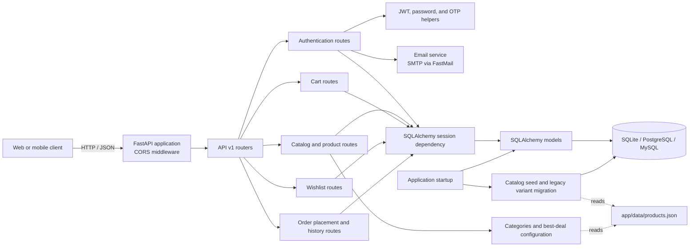
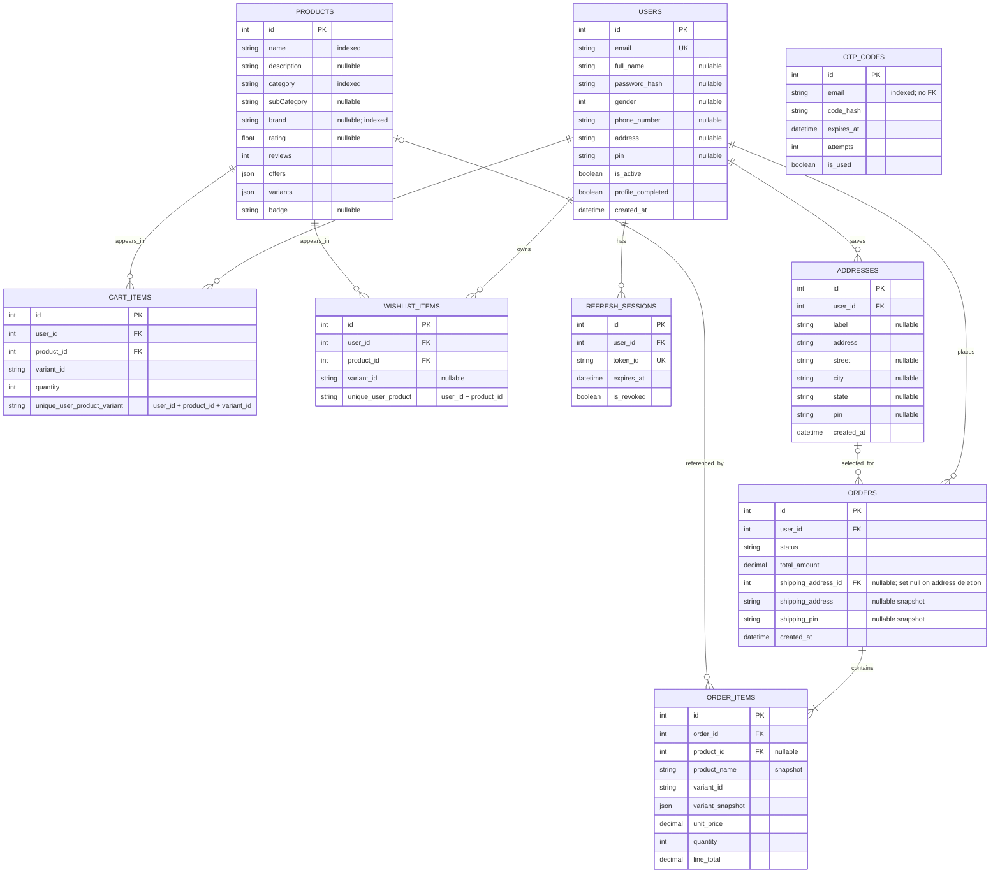

# ShopKart API

ShopKart is a FastAPI service for authentication, product catalog browsing, carts, and wishlists. It uses SQLAlchemy for persistence and supports SQLite, PostgreSQL, and MySQL connection URLs.

## Architecture



### Main code areas

| Area | Responsibility |
| --- | --- |
| `app/main.py` | Loads configuration, creates tables, repairs legacy refresh-session keys, runs catalog migrations/seeding, configures CORS, and mounts the API router. |
| `app/api/v1/endpoints/` | HTTP endpoints for auth, catalog, products, cart, wishlist, and order operations. |
| `app/api/deps.py` | Shared authentication dependencies, including the current-user dependency. |
| `app/schemas/` | Pydantic request and response schemas. |
| `app/models/` | SQLAlchemy table models. |
| `app/db/session.py` | Database engine, session factory, and database compatibility helpers. |
| `app/core/security.py` | JWT and OTP creation, hashing, and expiry settings. |
| `app/services/` | Catalog serialization/seeding/migrations and email configuration. |

## Database tables and relationships

The diagram below documents the nine SQLAlchemy tables currently declared by the application. `users` and `products` are parent tables; saved addresses, cart and wishlist rows, refresh sessions, and orders belong to users. Orders contain item snapshots. Product variants are embedded as JSON in `products.variants`, so they are not a separate current table.



### Relationship details

| Parent | Child | Cardinality | Foreign key / constraint |
| --- | --- | --- | --- |
| `users` | `cart_items` | One user to many cart rows | `cart_items.user_id → users.id`; deleting a user cascades to its cart rows. |
| `products` | `cart_items` | One product to many cart rows | `cart_items.product_id → products.id`; deleting a product cascades to its cart rows. |
| `users` | `wishlist_items` | One user to many wishlist rows | `wishlist_items.user_id → users.id`; no delete cascade is declared on this FK. |
| `products` | `wishlist_items` | One product to many wishlist rows | `wishlist_items.product_id → products.id`; deleting a product cascades to its wishlist rows. |
| `users` | `refresh_sessions` | One user to many refresh sessions | `refresh_sessions.user_id → users.id`; no delete cascade is declared on this FK. |
| `users` | `addresses` | One user to many saved addresses | `addresses.user_id → users.id`; deleting a user cascades to saved addresses. Registration creates a `Home` address, and existing legacy user addresses are copied into this table at startup when missing. |
| `users` | `orders` | One user to many orders | `orders.user_id → users.id`; order history is scoped to the authenticated user. |
| `addresses` | `orders` | One saved address may be selected for many orders | Nullable `orders.shipping_address_id → addresses.id` with `ON DELETE SET NULL`; address and PIN snapshots remain after address edits or deletion. |
| `orders` | `order_items` | One order to one or more line items | `order_items.order_id → orders.id`; deleting an order cascades to its items. |
| `products` | `order_items` | One product may be referenced by many order items | Nullable `order_items.product_id → products.id` with `ON DELETE SET NULL`; order item names, variant, and prices are snapshots. |
| — | `otp_codes` | No relational FK | OTP records are looked up by email; the schema does not link them to `users.id`. |

`cart_items` enforces one row per `(user_id, product_id, variant_id)`. `wishlist_items` enforces one row per `(user_id, product_id)`; its `variant_id` is optional metadata and does not change that uniqueness rule. Both `cart_items` and `wishlist_items` contain foreign keys to `users` and `products`, although only the product model declares an ORM relationship property.

### API routes

Routes are mounted directly on the FastAPI application (there is no `/api/v1` URL prefix). All routes below use the listed paths. Endpoints marked **Bearer** require an access token in `Authorization: Bearer <token>`.

| Area | Routes | Notes |
| --- | --- | --- |
| Authentication | `POST /auth/register`, `/auth/login`, `/auth/send-otp`, `/auth/verify-otp`, `/auth/create-profile`, `/auth/refresh`, `/auth/logout`; `GET /auth/me`; `PATCH /auth/Edit-profile` | Password registration/login and email OTP flows; token refresh/logout and profile operations. |
| Catalog | `GET /home`; `GET /products`; `GET /products/{product_id}` | Home content includes categories, best deals, and paginated products. Product listing supports search, category, brand, price, rating, sorting, and pagination filters. |
| Cart (**Bearer**) | `GET /cart`; `POST /cart/items`; `PATCH /cart/items/{item_id}`; `DELETE /cart/items/{item_id}` | Cart rows identify a product variant and enforce available stock. |
| Wishlist (**Bearer**) | `GET /wishlist`; `POST /wishlist`; `DELETE /wishlist/{product_id}` | One entry per product per user, with the selected variant retained as metadata. |
| Addresses (**Bearer**) | `GET /addresses`; `POST /addresses`; `PATCH /addresses/{address_id}`; `DELETE /addresses/{address_id}` | Saved addresses are scoped to the authenticated user; create accepts a full address or structured street, city, and state fields. |
| Orders (**Bearer**) | `POST /orders`; `GET /orders` | Placement accepts a saved `address_id`, validates the caller-owned address, cart, selected variants, stock, and total in one transaction. History supports `page`, `pageSize`, and either `duration` (1–36 months) or `year`. |

The `products` API response uses the existing catalog JSON shape (`subCategory`, `parentId`, and related camelCase fields). List endpoints use `page` and `pageSize` query parameters where applicable; product/home pages allow up to 100 items per page.

### Product variants and legacy data

The `POST /orders` endpoint requires a JSON body containing the ID of one of the authenticated user's saved addresses, for example `{"address_id": 42}`. It validates that address and its six-digit PIN along with cart contents, selected variants, stock limits, and total before saving an order, decrementing the purchased stock, and clearing the cart in one transaction. Orders retain `shipping_address_id` as a nullable reference and snapshot `shipping_address` and `shipping_pin`, so order history remains stable if the saved address is edited or deleted. Existing orders keep a null address reference. `GET /orders` returns only that user's orders, newest first, with item snapshots and pagination (`page`, `pageSize`, maximum 100). It also accepts one date filter at a time:

- `duration=1` through `duration=36` for a rolling window ending now (UTC), where the value is a number of months.
- `year=2025` for orders placed during that calendar year (UTC).

For example: `GET /orders?page=1&pageSize=20&duration=6` or `GET /orders?year=2025`. Values outside the 1–36 month range or supplying both `duration` and `year` return HTTP 422. The total count and page count are calculated after applying the selected filter. Both endpoints require a valid access token in the `Authorization: Bearer <token>` header.

Current product variant data (including variant IDs, price, stock, and images) is stored inside the `products.variants` JSON column. The startup migration contains compatibility logic for a legacy `product_variants` table and copies its contents into that JSON column when appropriate. `product_variants` is not declared as a current SQLAlchemy model and is not part of the current entity relationship diagram.

On PostgreSQL, startup also repairs legacy `refresh_sessions` tables by reassigning duplicate or null session IDs without deleting sessions, ensuring the `id` primary key and unique `token_id` index, and synchronizing the ID sequence.

## Running locally

Install dependencies from `requirements.txt`, set any required environment variables, then start the API with:

```bash
uvicorn app.main:app --reload
```

The default database URL is `sqlite:///./auth.db`. Set `DATABASE_URL` to use another supported database. The product catalog is loaded from `app/data/products.json` when the database has no products. Authentication and email settings are configured with environment variables; see `app/core/security.py` and `app/services/email.py` for the names and defaults.

## Load testing

The Locust workload and instructions for simulating up to 10,000 concurrent clients are in [LOAD_TESTING.md](LOAD_TESTING.md).
